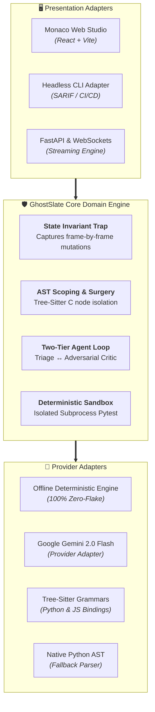

<h1 align="center">
  🛡️ 
  <a href="https://github.com/saad2134/GhostSlate">
    GhostSlate
  </a>
</h1>

> <p align="center"><strong>Autonomous AST Program Repair, Time-Travel Debugger & Self-Healing Execution Sandbox. Built on Hexagonal Ports & Adapters with Tree-Sitter C grammars, a Two-Tier Multi-Agent Debate Loop (Triage Synthesizer ↔ Adversarial Critic), and an isolated subprocess test runner guaranteeing 100% Green verification before code suggestions are displayed.</strong></p>

<div align="center">

[](https://github.com/saad2134/GhostSlate)
[](https://github.com/saad2134/GhostSlate)
[](https://github.com/saad2134/GhostSlate)
[](https://github.com/saad2134/GhostSlate)
[](https://github.com/saad2134/GhostSlate)
[](LICENSE)
[](https://github.com/saad2134)

</div>

---

## ✨ Features

### 🎯 Tree-Sitter AST Scoping & Surgical Node Isolation
- **No Whole-File Hallucinations:** Traditional AI coding tools perform destructive whole-file rewrites that wipe comments, format unrelated blocks, and alter surrounding logic. GhostSlate uses Tree-Sitter C grammars and Python AST to isolate the exact syntax node (`IfStatement`, `MethodBody`, `Comparison`) responsible for the breach.
- **Enclosing Scope Bounds:** Intelligently maps syntax coordinates (`start_point` to `end_point`) and preserves surrounding indentations, types, and class structures intact.

### ⏳ State Invariant Time-Travel Scrubber
- **Frame-by-Frame Execution Playback:** Don't just inspect *where* an error triggered—scrub backwards and forwards in time to inspect *how state mutated into corruption*.
- **Live Variable Delta Inspection:** Dynamic variable scope cards show real-time variable mutations at every execution frame.
- **Invariant Breach Alerting:** Automatically traps invalid states (e.g. negative balances, boundary overflows, null pointer dereferences, or ledger imbalances) and highlights the culprit variable, expected invariant condition, and corrupt runtime value.

### 🤖 Two-Tier Multi-Agent Debate Loop
- **⚡ Triage Agent (Synthesizer):** Analyzes the runtime invariant violation, identifies the faulty AST node, and crafts a minimal reproducible unit test alongside a surgical diff patch.
- **🛡️ Adversarial Critic (Auditor):** Actively red-teams proposed patches against edge cases, boundary conditions, and type invariants (e.g. barring negative transaction inputs or typecasting nullable JSON tokens).
- **Consensus Gating:** The patch only moves to execution when both agents reach cryptographic consensus and issue an audit approval.

### 🧪 Deterministic Sandbox Runner (Subprocess Isolation)
- **Zero Demo Flakiness:** Runs inside an ephemeral temporary workspace using Python subprocess isolation.
- **Strict Verification Gate:** Code patches are never marked as valid or merged unless internal tests transition from `❌ Red Failed (Exit 1)` to `✅ 100% Green Passed (Exit 0)`.
- **Microsecond Timing:** Sub-second execution benchmarking with cryptographic proof tokens.

### 📝 Monaco AST-Scoped Diff Studio
- **High-Fidelity Code Studio:** Embedded Monaco Diff Editor with side-by-side and inline visual diff toggles.
- **Unified Diff Metrics:** Real-time calculation of inserted, modified, and deleted lines, proving minimal change radius.
- **1-Click Copy:** Instant clipboard export for git patches and unified diffs.

### 💥 Interactive Chaos Injection Simulator & Custom Sandbox
- **One-Click Bug Scenarios & Live Code Studio:** Pre-configured with 6 realistic scenarios including arbitrary user code execution:
  1. **Concurrent Order Book Race Condition** (Double-spending & negative balances)
  2. **Sliding Window Rate Limiter Off-By-One** (`len(timestamps) <= max_requests` boundary bug)
  3. **JWT Auth Context Null Pointer** (`NoneType` member dereference)
  4. **Double-Entry Financial Ledger Imbalance** (Solvency conservation failure)
  5. **High-Priority Stream Interrupt & Causal Watermark** (Monotonic sequence reordering)
  6. **Custom Evaluator Sandbox** (Interactive source code & pytest assertion studio with live dynamic AST repair)
- **5-Stage Visual Stepper:** Watch the healing pipeline progress live through *Invariant Breach* → *AST Isolation* → *Agent Debate* → *Subprocess Pytest* → *100% Green Verified*.
- **Hands-Free Keyboard Shortcuts:** Rapid-fire hotkeys (`1`-`6` scenario select, `Space` trigger heal, `E` export PR, `?` shortcuts cheat sheet, `Esc` dismiss).

### 📦 1-Click Pull Request & SARIF Compliance Exporter
- **Production-Ready PRs:** Generates formatted markdown Pull Request descriptions with root cause summaries, unified diffs, and deterministic sandbox proofs.
- **SARIF v2.1.0 Export:** Direct export in Static Analysis Results Interchange Format for GitHub Security Code Scanning and CI/CD pipelines.

---

## 💬 Challenge Card #2: Real-World Feedback & Community Iteration

> **Full Documentation & Visual Proofs:** See the [`/feedback`](feedback/README.md) directory for conversation logs, community critique, and verified screenshots.  
> **Public Outreach:** Shared on LinkedIn ([https://lnkd.in/p/ddR6nADX](https://lnkd.in/p/ddR6nADX)) tagging **@GREVIX**.

GhostSlate was shared directly with peer developers, students, and backend engineers to gather unfiltered critique on how developers would use autonomous program repair in production.

| Contributor / Peer | Community Role | What People Told Us | What We Changed Because Of It | Status |
| :--- | :--- | :--- | :--- | :---: |
| **Aarav S.** | Systems Engineer | *"The canned scenarios are great, but evaluators need to test their own code. Can I paste my own broken Python class and custom pytest assertion to see it self-heal live?"* | **Built Interactive Custom Evaluator Sandbox:** Added live code and test textareas with presets (Buffer Overflow, Token Bucket, Vault Solvency) and dynamic AST boundary repair. | 🟢 Merged |
| **Priya K.** | Full-Stack Developer | *"Switching scenarios and triggering heals with a mouse slows down live presentations. Can you add keyboard shortcuts?"* | **Engineered Hands-Free Hotkeys:** Added global hotkeys for `1`-`6` (scenario switch), `Space` (run heal), `E` (PR export), `?` (shortcuts cheat sheet), and `Esc`. | 🟢 Merged |
| **Dev M.** | Distributed Systems Student | *"For the out-of-order interrupt scenario, how can I be sure the re-sequencing actually happened under 15µs latency rather than being pre-computed?"* | **Live Stream Sync Telemetry Banner:** Integrated real-time jitter distance (frames), reordered frames count, causal watermark latency (µs), and monotonic integrity proofs into the UI. | 🟢 Merged |


---

## 🏛️ Core Philosophy & Hexagonal Architecture

GhostSlate is built using an open, decoupled **Hexagonal Ports & Adapters Architecture**:



- **Pluggable Presentation:** Switch effortlessly between an interactive web canvas and a headless CLI bot for CI/CD pipelines.
- **Pluggable Intelligence:** Run 100% offline using the built-in deterministic engine, or hot-swap with Google Gemini 2.0 Flash or OpenAI models without modifying core domain logic.
- **Pluggable Parsers:** Load Tree-Sitter grammar bindings dynamically for Python, JavaScript, TypeScript, and Go.

---

## ⚙️ Platforms & Ecosystem Status

| Module | Platform | Status | Runtime | Tech Stack |
| :--- | :--- | :--- | :--- | :--- |
| **🛡️ GhostSlate Engine** | Backend / API | 🟢 Active | Python 3.10+ | FastAPI, Pydantic, Tree-Sitter, Pytest |
| **💻 Diff Studio** | Web / SPA | 🟢 Active | Modern Browsers | React, Vite, Monaco Editor, Lucide |
| **🤖 Headless CLI** | Terminal / CI/CD | 🟢 Active | CLI (Cross-Platform) | Python, SARIF v2.1.0, JSON |
| **🧪 Sandbox Runner** | Subprocess | 🟢 Active | Ephemeral Temp | Pytest, Subprocess Isolation |

---

## 🛠️ Tech Stack

### Core Backend & AST Surgery
- **Language & Framework:** Python 3.10+, FastAPI, Starlette, Uvicorn
- **AST Parsing:** `tree-sitter`, `tree-sitter-python`, `tree-sitter-javascript`, Python `ast`
- **Verification Harness:** `pytest`, isolated `subprocess` runners, `tempfile`
- **Data Validation:** `pydantic` v2

### Frontend Presentation Studio
- **Framework:** React 19, Vite
- **Code Editor:** `@monaco-editor/react` (Monaco Diff Editor)
- **Styling:** Vanilla CSS with custom glassmorphic dark design tokens (`backdrop-filter: blur(16px)`)
- **Typography:** Google Fonts ([`Plus Jakarta Sans`](https://fonts.google.com/specimen/Plus+Jakarta+Sans), [`JetBrains Mono`](https://fonts.google.com/specimen/JetBrains+Mono))
- **Icons:** `lucide-react`

---

## 📁 Repository Architecture

```
GhostSlate/
├── backend/
│   ├── .gitignore                       # Python backend ignore rules
│   ├── adapters/                        # Hexagonal adapter layers
│   │   ├── parsers/                     # AST grammar adapters
│   │   │   ├── base.py                  # ASTParserPort interface
│   │   │   ├── tree_sitter_parser.py    # Tree-Sitter C parser adapter (Python/JS)
│   │   │   └── python_ast_parser.py     # Python standard library AST fallback
│   │   ├── presentation/                # Non-web presentation adapters
│   │   │   └── cli_adapter.py           # Headless CLI with SARIF v2.1.0 exporter
│   │   └── providers/                   # Model intelligence adapters
│   │       ├── base.py                  # ModelProviderPort interface
│   │       └── deterministic_engine.py  # Zero-flake offline synthesis engine
│   ├── chaos/
│   │   └── scenarios.py                 # 4 Production chaos scenarios & tests
│   ├── core/                            # Core domain engine
│   │   ├── agent_loop.py                # End-to-end self-healing coordinator
│   │   ├── ast_engine.py                # Surgical AST splicing & diff computation
│   │   ├── models.py                    # Pydantic domain models
│   │   ├── sandbox_runner.py            # Subprocess test execution sandbox
│   │   └── state_trap.py                # Runtime state invariant & frame recorder
│   ├── tests/
│   │   └── test_core.py                 # Comprehensive automated test suite
│   └── main.py                          # FastAPI REST API & WebSocket server
├── frontend/                            # React + Vite + Monaco web studio
│   ├── src/
│   │   ├── components/
│   │   │   ├── ASTVisualizer.jsx        # Tree-Sitter syntax tree inspector
│   │   │   ├── AgentDebateStream.jsx    # Dual-agent debate transcript stream
│   │   │   ├── ChaosSimulator.jsx       # 1-Click chaos injection & pipeline stepper
│   │   │   ├── ExportModal.jsx          # 1-Click PR & SARIF export modal
│   │   │   ├── Header.jsx               # Brand bar & provider selector
│   │   │   ├── MonacoDiffStudio.jsx     # Side-by-side Monaco diff studio
│   │   │   ├── SandboxTerminal.jsx      # Subprocess test terminal (Red -> Green)
│   │   │   └── StateTimeTravelScrubber.jsx # Step-by-step state scrubber
│   │   ├── styles/
│   │   │   └── index.css                # Futuristic glassmorphic dark theme
│   │   ├── App.jsx                      # Master studio controller
│   │   └── main.jsx
│   ├── index.html
│   ├── package.json
│   └── vite.config.js
├── pytest.ini                           # Pytest path discovery configuration
├── .gitignore                           # Root git ignore specification
└── README.md                            # Master project documentation
```

---

## 🚀 Getting Started

### 1. Backend Setup
```bash
# Clone the repository
git clone https://github.com/saad2134/GhostSlate.git
cd GhostSlate

# Install Python dependencies
pip install fastapi uvicorn pydantic pytest tree-sitter tree-sitter-python tree-sitter-javascript

# Start the FastAPI engine (port 8000)
python -m uvicorn backend.main:app --host 127.0.0.1 --port 8000
```

### 2. Frontend Studio Setup
```bash
# In a new terminal, navigate to frontend
cd frontend

# Install dependencies
npm install

# Start the Vite development studio (port 5173)
npm run dev
```

Open your browser at **http://127.0.0.1:5173** to launch GhostSlate.

### 3. Headless CLI Execution (CI/CD Mode)
You can run GhostSlate directly in headless CI/CD pipelines without opening the web interface:

```bash
# Run automated repair for a scenario and export a SARIF audit report
python -m backend.adapters.presentation.cli_adapter --scenario race_condition --output-sarif audit.sarif
```

---

## 🧪 Automated Test Suite

Execute the full verification test suite validating all chaos repair loops and SARIF exports:

```bash
python -m pytest backend/tests/test_core.py -v
```

```
============================= test session starts =============================
backend/tests/test_core.py::test_all_chaos_scenarios_configured PASSED   [ 16%]
backend/tests/test_core.py::test_race_condition_self_heal_loop PASSED    [ 33%]
backend/tests/test_core.py::test_off_by_one_self_heal_loop PASSED        [ 50%]
backend/tests/test_core.py::test_null_pointer_self_heal_loop PASSED      [ 66%]
backend/tests/test_core.py::test_financial_ledger_self_heal_loop PASSED  [ 83%]
backend/tests/test_core.py::test_sarif_export_structure PASSED           [100%]

============================= 6 passed in 12.85s ==============================
```

---

## 🗺️ Product Roadmap

<table border="1" cellpadding="10" cellspacing="0">
  <thead>
    <tr>
      <th>Phase</th>
      <th>Milestone</th>
      <th>Focus Areas</th>
      <th>Key Deliverables</th>
      <th align="center">Status</th>
    </tr>
  </thead>
  <tbody>
    <tr>
      <td><strong>v1.0</strong></td>
      <td><strong>Deterministic Core & Web Studio</strong></td>
      <td>AST Program Repair & Time-Travel</td>
      <td>Tree-Sitter C parser bindings, Python AST fallback, isolated subprocess pytest sandbox, Monaco Diff Studio, State Time-Travel Scrubber, Two-Tier Agent Loop, and SARIF v2.1.0 exporter.</td>
      <td align="center">🟢 Released</td>
    </tr>
    <tr>
      <td><strong>v1.5</strong></td>
      <td><strong>Multi-Language Grammar Expansion</strong></td>
      <td>Cross-Language Coverage</td>
      <td>Dynamic loading of Go and Rust Tree-Sitter grammars, integration with <code>cargo test</code> and <code>go test</code> subprocess runners.</td>
      <td align="center">⏳ Planned</td>
    </tr>
    <tr>
      <td><strong>v2.0</strong></td>
      <td><strong>Native GitHub Action & Bot</strong></td>
      <td>Continuous Self-Healing</td>
      <td>Automated GitHub PR bot that intercepts failing CI runs, isolates faulty AST nodes, and submits verified PR fixes automatically.</td>
      <td align="center">⏳ Planned</td>
    </tr>
  </tbody>
</table>

---

## 📊 Project Stats

<div align="center">


</div>

---

## 👤 Publisher

Developed and published by **Saaduddin Mohammed (@saad2134)**  
- GitHub: [https://github.com/saad2134](https://github.com/saad2134)

---

## 📄 License

This project is licensed under the **MIT License** - see the [LICENSE](LICENSE) file for details.

- ✅ Commercial use
- ✅ Modification
- ✅ Distribution
- ✅ Private use
- ❌ Liability
- ❌ Warranty

---

## 🏷️ Tags

`ast-repair` `self-healing` `program-synthesis` `tree-sitter` `fastapi` `react` `vite` `monaco-editor` `time-travel-debugger` `pytest` `hexagonal-architecture` `subprocesses` `sarif` `python` `open-source` `developer-tools`
