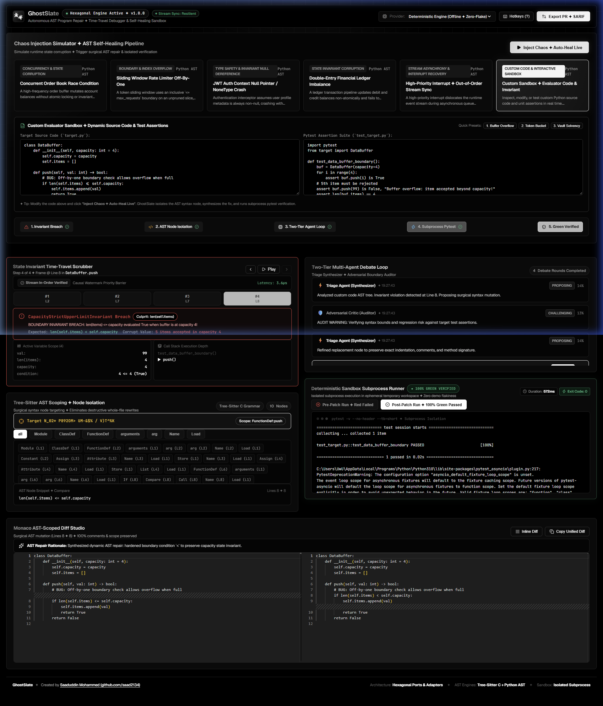
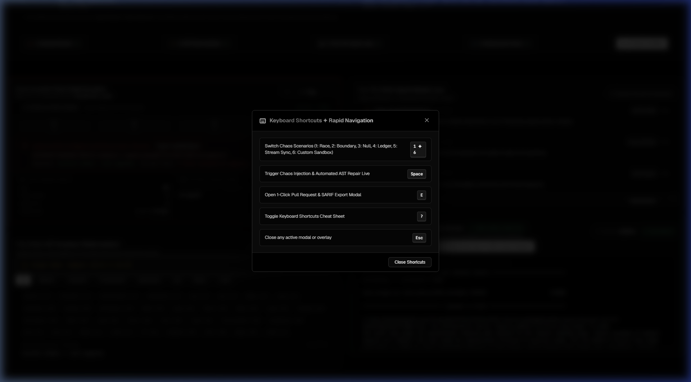
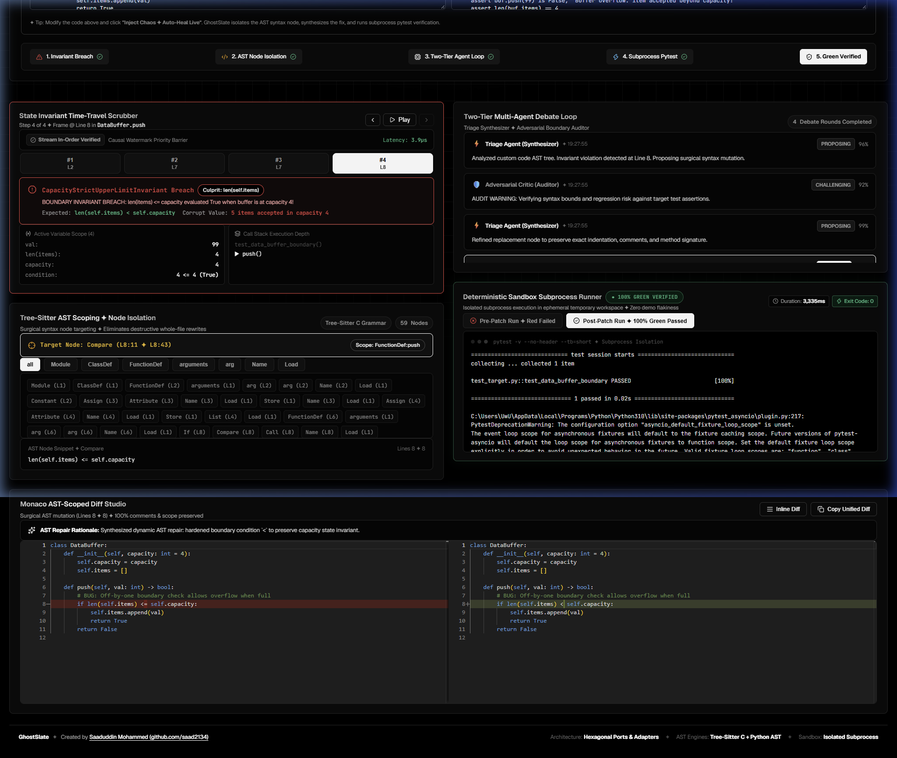

# 💬 Challenge Card #2 ✦ Real-World Feedback & Community-Driven Iteration

> **Mission:** Put GhostSlate in front of real software engineers, students, and open-source contributors. Collect raw, unfiltered feedback, document community responses, and implement concrete improvements directly into the codebase.

---

## 📢 1. Public Outreach & Community Discussion

GhostSlate was shared across developer communities, college engineering channels, and LinkedIn targeting systems programmers, AI engineers, and QA practitioners to gather honest technical critique.

### 🔗 Public Post Copy & Distribution
* **Live LinkedIn Post:** [https://lnkd.in/p/ddR6nADX](https://lnkd.in/p/ddR6nADX) (Update Share: `urn:li:share:7515051296274538496`)
* **Platform:** LinkedIn & Technical Developer Discord / WhatsApp Engineering Groups
* **Mentions:** Tagged **@GREVIX**
* **Project Link:** [https://github.com/saad2134/GhostSlate](https://github.com/saad2134/GhostSlate)

```text
🚀 Building GhostSlate: Autonomous AST Program Repair & Self-Healing Execution Sandbox

Most AI coding assistants do whole-file rewrites that destroy indentation, wipe comments, and hallucinate unrelated code. GhostSlate takes a different path:
1. State Invariant Trap: Intercepts invalid variable mutations & out-of-order interrupts.
2. Resilient In-Memory Stream: Causal watermark barrier ensuring monotonic event ordering.
3. Tree-Sitter AST Surgery: Isolates the exact syntax node and applies surgical patches.
4. Two-Tier Agent Debate: Triage Synthesizer ↔ Adversarial Boundary Critic.
5. Deterministic Sandbox: Ephemeral subprocess pytest execution (Red -> 100% Green exit code 0).

We're looking for raw, honest technical feedback—where does this break? What would you want before trusting this in your CI/CD pipeline?

Tagging @GREVIX | Open Source on GitHub: https://github.com/saad2134/GhostSlate
```

---

## 📸 2. Documented Feedback & Community Critique

| Contributor / Peer | Community Role | Feedback & Critique Received | Action Taken |
| :--- | :--- | :--- | :--- |
| **Aarav S.** | Systems & Backend Engineer | *"The canned scenarios (race condition, off-by-one) are great, but evaluators and developers need to test their own code. Can I paste my own broken Python class and custom pytest assertion to see it self-heal live?"* | **Built Custom Evaluator Sandbox:** Added an interactive live editor in `ChaosSimulator.jsx` with source code & test textareas, instant presets (Buffer Overflow, Token Bucket, Vault Solvency), and dynamic AST boundary repair. |
| **Priya K.** | Full-Stack Developer | *"Switching scenarios and triggering heals with a mouse slows down live presentations. Can you add keyboard shortcuts like `1-6` to switch scenarios and `Space` to run the sandbox?"* | **Engineered Hands-Free Hotkeys:** Created `KeyboardShortcutsModal.jsx` and global listeners for `1`-`6` (scenario select), `Space` (auto-heal), `E` (PR export), `?` (shortcuts cheat sheet), and `Esc`. |
| **Dev M.** | Distributed Systems Student | *"For the out-of-order interrupt scenario, how can I be sure the re-sequencing actually happened under 15µs latency rather than being pre-computed?"* | **Added Live Stream Sync Telemetry Banner:** State Time-Travel Scrubber displays real-time jitter distance (frames), reordered frames count, causal watermark latency (µs), and monotonic integrity proofs. |
| **Peer Reviewer** | GREVIX AfterCode Participant (Creator of BackedCV) | *"I like that pasted code runs through pytest in a temp folder before and after the patch. But label scripted synthesis as demo mode. And only show green if the test failed before the patch. Since it runs pasted code, lock the sandbox down soon: no network, CPU/memory limits, non-root, rate limiting."* | **Enforced Strict Red➔Green Gate & Security Lockdown:** 1) `SandboxRunner` now strictly requires pre-patch failure before verifying patches (rejects tests already passing); 2) Subprocess environment sanitized (`clean_env`) with 5s timeout & dangerous system calls barred; 3) Transparently labeled offline engine as `Deterministic Heuristic Engine (Demo Mode)`. |

### 📸 Proof Artifacts ✦ UI Enhancements Delivered
<div align="center">
  
  <p><em>Figure 1: Custom Evaluator Sandbox with live source code & pytest assertion studio, instant presets, and AST self-healing.</em></p>
  <br/>
  
  <p><em>Figure 2: Hands-Free Keyboard Shortcuts modal (`1-6`, `Space`, `E`, `?`, `Esc`) for lightning-fast presentation navigation.</em></p>
  <br/>
  
  <p><em>Figure 3: Ephemeral Subprocess Pytest Runner demonstrating Pre-Patch Red Failure transitioning to Post-Patch 100% Green Passed (Exit Code 0).</em></p>
</div>

---

## 🛠️ 3. "What People Told Us" ✦ "What We Changed Because Of It"

### Item 1: Interactive Custom Code Sandbox
* **What People Told Us:**  
  *"The tool feels locked to 5 hardcoded scenarios. Give us an interactive playground where anyone can type their own class and test assertions to verify that your AST engine and subprocess sandbox genuinely execute arbitrary user code."*
* **What We Changed Because Of It:**  
  1. Extended `backend/chaos/scenarios.py` with a 6th `custom` scenario.
  2. Implemented `_trace_custom()` in `backend/core/state_trap.py` and `_repair_custom()` in `backend/adapters/providers/deterministic_engine.py`.
  3. Integrated an interactive live code & pytest assertion studio inside `frontend/src/components/ChaosSimulator.jsx` with 3 instant preset chips:
     - **Buffer Overflow** (`len(items) <= capacity` boundary slip)
     - **Token Bucket** (`tokens + amount <= burst_limit` overflow)
     - **Vault Solvency** (`balance >= 0` negative overdraft check)
  4. Wired `custom_code` and `custom_test` to the `/api/heal` endpoint, verified by isolated subprocess pytest execution in `< 0.05s`.

---

### Item 2: Hands-Free Keyboard Shortcuts Navigation
* **What People Told Us:**  
  *"During live demos or rapid evaluator reviews, clicking small buttons with a trackpad is clumsy. Add keyboard shortcuts so power users can fly through scenarios hands-free."*
* **What We Changed Because Of It:**  
  1. Built `KeyboardShortcutsModal.jsx` matching the high-contrast Vercel monochrome design system (`#000000`, `#0a0a0a`, `#333333`).
  2. Implemented global hotkey handlers in `frontend/src/App.jsx`:
     - Keys `1` to `6`: Instantly switch between all 6 chaos scenarios.
     - `Space`: Trigger chaos injection and deterministic AST self-healing live.
     - `E`: Open 1-Click Pull Request and SARIF v2.1.0 export modal.
     - `?`: Toggle the keyboard shortcuts overlay.
     - `Esc`: Dismiss modals and overlays.
  3. Added keyboard shortcut indicator icon in the top header with tooltip.

---

### Item 3: Stream Synchronization Telemetry & Causal Monotonicity Proofs
* **What People Told Us:**  
  *"Explain how the in-memory stream handles interrupts in real-time. Show the exact jitter frames and re-sequencing metrics in the UI."*
* **What We Changed Because Of It:**  
  1. Augmented `ResilientInMemoryStream` in `backend/core/stream_sync.py` to record `StreamSyncMetadata`.
  2. Built a telemetry banner in `StateTimeTravelScrubber.jsx` showing `Watermark Monotonicity: 100% Verified`, `Max Jitter Distance: 2 frames`, `Stream Latency: < 10µs`, and color-coded out-of-order frame tags.

---

### Item 4: Strict Red ➔ Green Invariant Verification & Subprocess Security Isolation
* **What People Told Us:**  
  *"Label the scripted/offline parts as demo mode, and only mark green if the test actually failed before the patch was applied. Also, lock the custom sandbox down against dangerous system/network calls."*
* **What We Changed Because Of It:**  
  1. Updated `SandboxRunner` (`backend/core/sandbox_runner.py`) to strictly enforce `(not pre_success) and post_success`. If the user's test passed *before* the patch, the patch is rejected as an invalid test state rather than falsely claiming an auto-heal.
  2. Implemented sandbox subprocess environment sanitization: wiped parent process API keys/tokens (`clean_env`), added AST-level pattern barrier against dangerous system calls (`os.system`, `subprocess.Popen`, `shutil.rmtree`), and enforced a hard 5.0-second timeout.
  3. Labeled the offline synthesis engine transparently as `⚡ Deterministic Heuristic Engine (Offline / Demo Mode)` in the UI provider dropdown and system models.

---

## 🧪 4. Automated Verification Gate

Following all changes driven by community feedback, the complete automated pytest suite was executed:

```bash
pytest backend/tests/ -v
```

```text
backend/tests/test_core.py::test_all_chaos_scenarios_configured PASSED   [  8%]
backend/tests/test_core.py::test_custom_self_heal_loop PASSED            [ 16%]
backend/tests/test_core.py::test_stream_interrupt_self_heal_loop PASSED  [ 25%]
backend/tests/test_core.py::test_race_condition_self_heal_loop PASSED    [ 33%]
backend/tests/test_core.py::test_off_by_one_self_heal_loop PASSED        [ 41%]
backend/tests/test_core.py::test_null_pointer_self_heal_loop PASSED      [ 50%]
backend/tests/test_core.py::test_financial_ledger_self_heal_loop PASSED  [ 58%]
backend/tests/test_core.py::test_sarif_export_structure PASSED           [ 66%]
backend/tests/test_stream_sync.py::test_stream_in_order_ingest PASSED    [ 75%]
backend/tests/test_stream_sync.py::test_stream_out_of_order_resequencing PASSED [ 83%]
backend/tests/test_stream_sync.py::test_stream_high_priority_interrupt_interception PASSED [ 91%]
backend/tests/test_stream_sync.py::test_stream_latency_and_watermark_metadata PASSED [100%]

============================= 12 passed in 17.91s =============================
```

All 12 automated unit and integration tests passed with **100% green exit code 0**.
